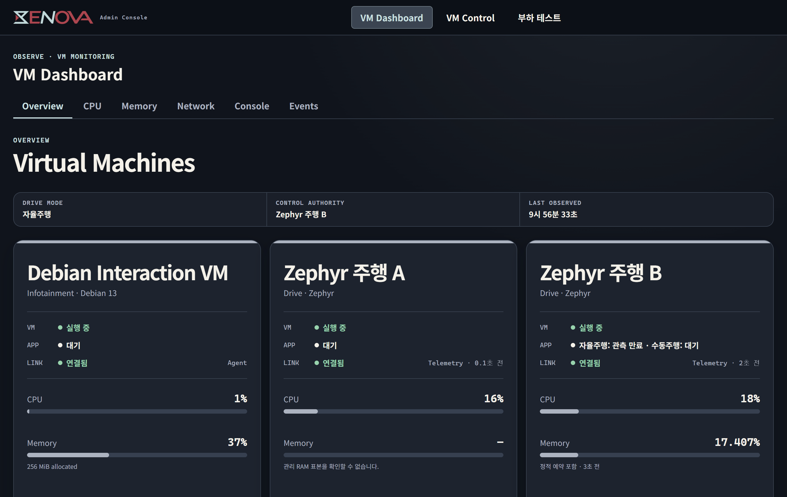
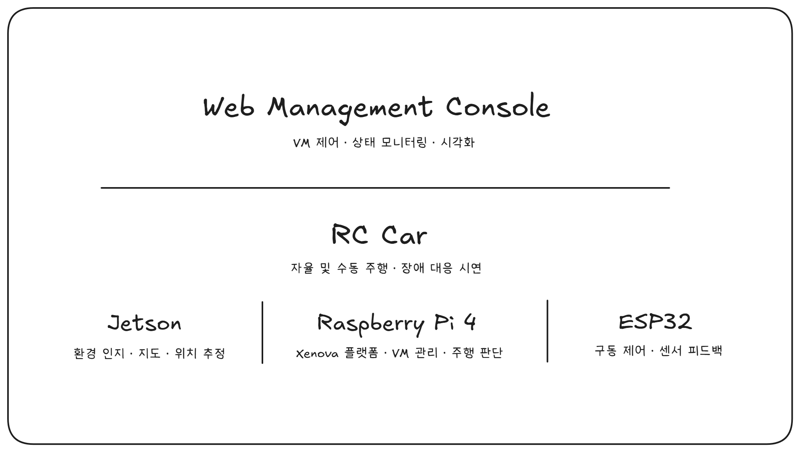
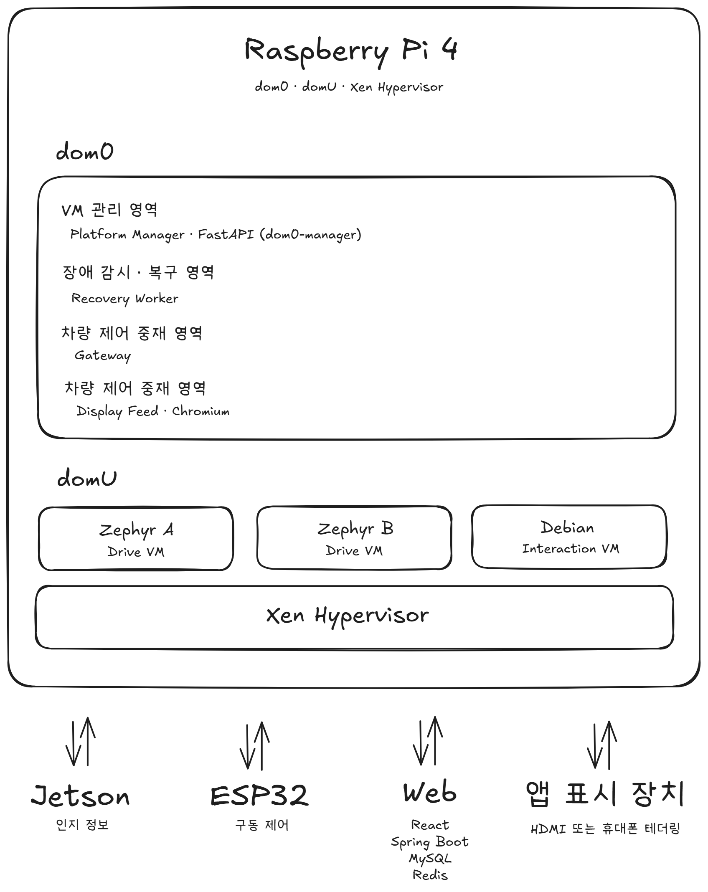
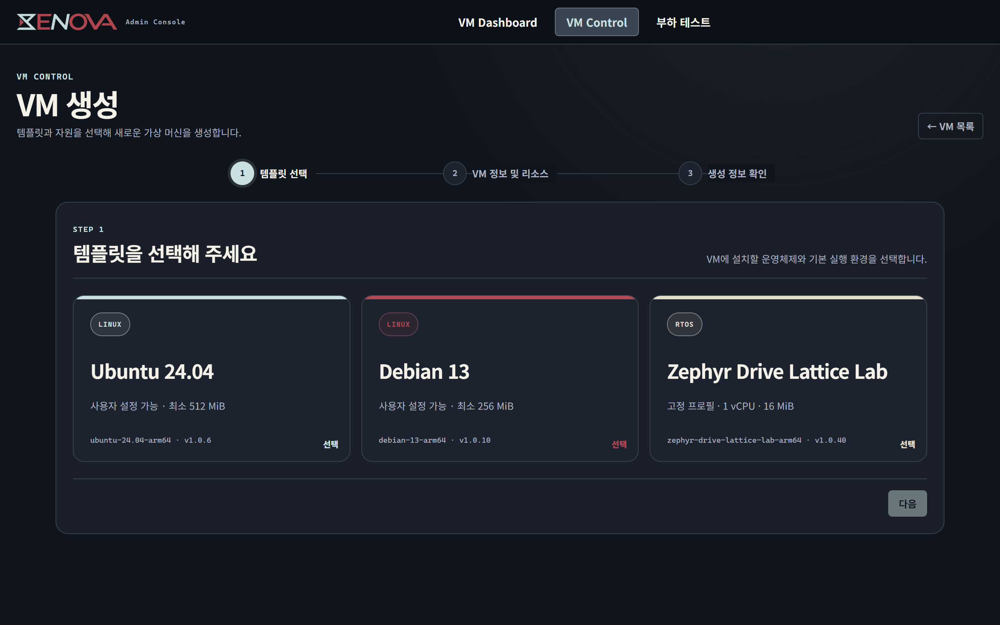
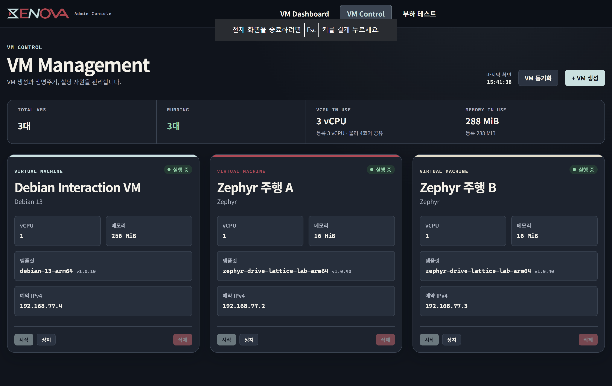
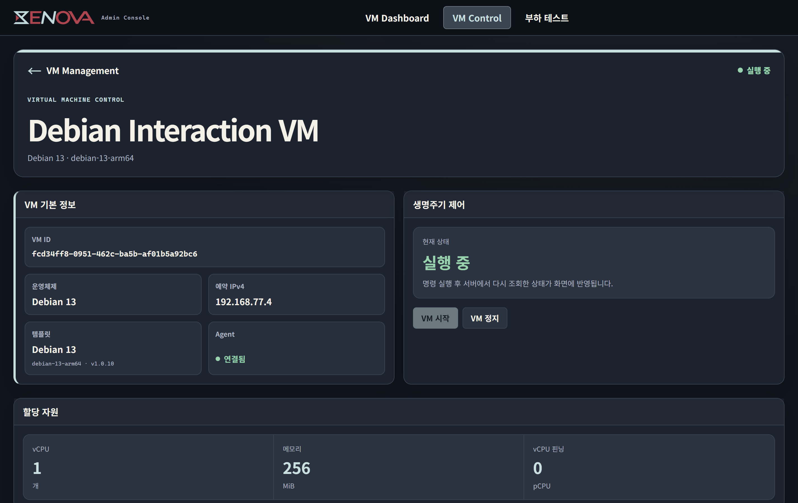
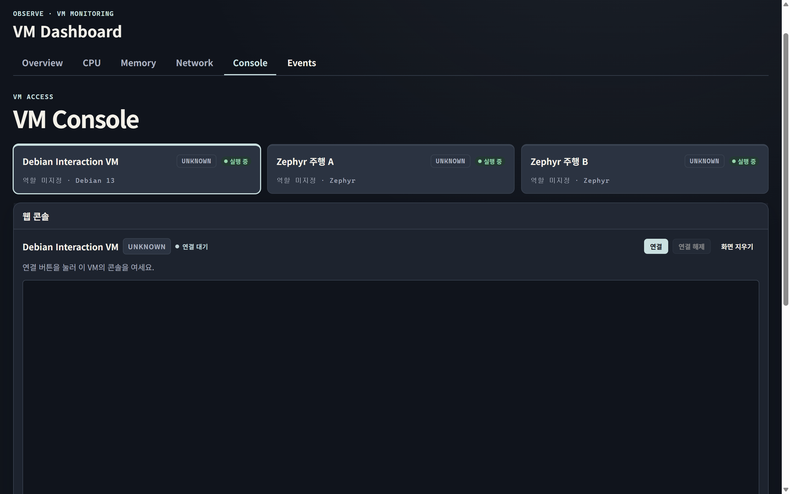
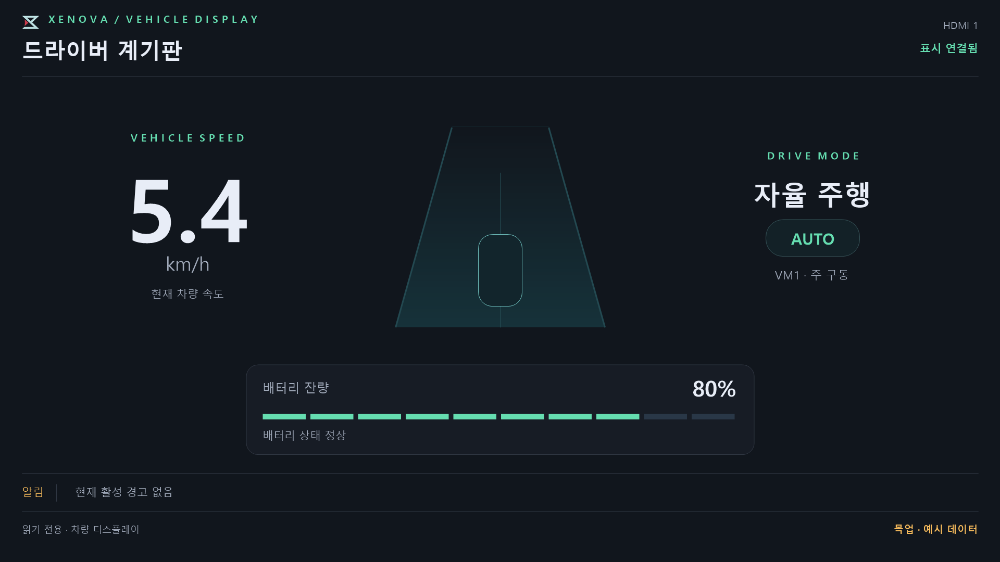
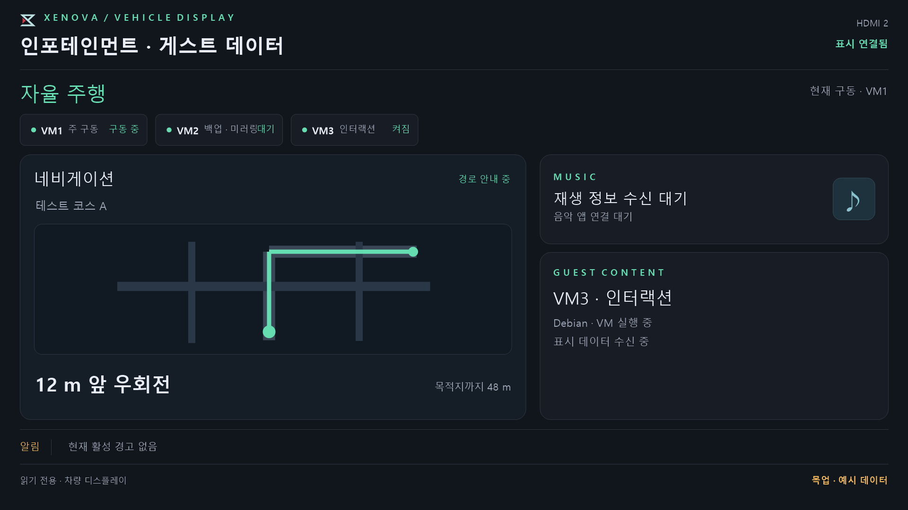
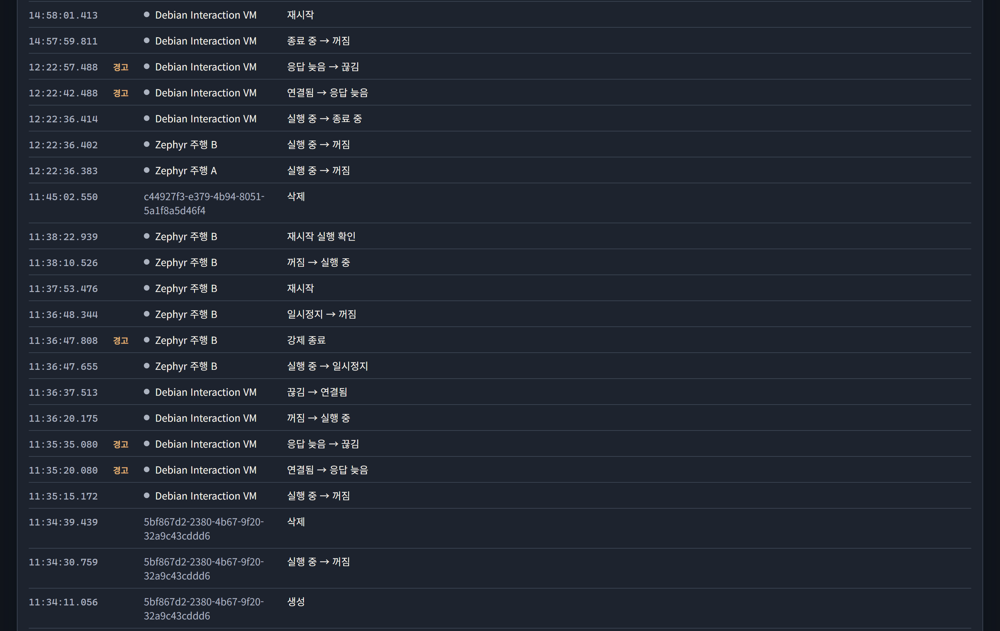

<div align="center">

# XENOVA

### Xen 기반 차량용 멀티 OS 관리·장애 대응 플랫폼


`Xen 하이퍼바이저` · `멀티 OS 격리` · `VM 장애 복구` · `주행 제어권 이중화` · `자율주행 RC카`

</div>

---

XENOVA는 Raspberry Pi 4 한 대에 Xen 하이퍼바이저를 올리고, Linux와 Zephyr RTOS를 서로 격리된 VM으로 돌리며
관리하는 임베디드 가상화 플랫폼이다. 자율주행 RC카를 응용 사례로 삼아 **주행 VM 하나가 죽어도 대기 VM이 제어권을
이어받고, 죽은 VM은 스스로 복구되는** 구조를 실제 차량에서 검증했다.

SSAFY 자율 프로젝트 · 2026.10 – 11 · 6인 팀 프로젝트 · 이 저장소는 팀 GitLab 모노레포를 커밋 이력째 옮긴 것이다.
필자는 CTRL·차량 파트를 맡아 보드의 VM 관리·복구 서비스와, 주행 명령이 바퀴까지 가는 하위 경로(ESP32 펌웨어·
Gateway 연동·실차 주행)를 만들었다. 이 README 는 필자의 범위를 중심으로 쓴다.

**Key Results** — 주행 · 이중화 · 안전
- 실차 자율주행: Jetson 차선 인식과 깊이 기반 장애물 회피로 303 × 194 cm 2차로 트랙을 한 바퀴 넘게(9.5 m) 주행
- 주행 VM 이중화: 활성 Zephyr VM이 멈추면 대기 VM이 약 0.3초 만에 제어권을 넘겨받음 (바퀴를 띄운 실보드 시험)
- 하위 안전 장치: ESP32가 명령마다 80 ms 수명을 걸어 상위가 멈춰도 스스로 출력을 끊고, 15 cm 앞 물체에서 제동



## 프로젝트 한눈에 보기

| 구분 | 내용 |
|---|---|
| 해결하려는 문제 | 한 보드에서 여러 OS를 돌릴 때 한 VM의 장애가 차량 주행 전체를 멈추지 않게 하기 |
| 하드웨어 | Raspberry Pi 4 (8GB) · Jetson Nano + OAK-D-Lite · ESP32 DevKitC · RC카 구동계 · VL53L0X ToF |
| 소프트웨어 | Xen (ARM64) · Yocto dom0 · Zephyr 주행 VM A/B · Debian 인터랙션 VM · FastAPI · Spring Boot · React |
| 통신 | MQTT (Mosquitto) · REST · WebSocket · USB 시리얼 460800 bps (자체 규약 feedback-3) |
| 필자 범위 | dom0-manager · Recovery Worker · VM Agent · ESP32 펌웨어 · Gateway 수정 · 실차 주행 도구 · RC카 조립 |

## 무엇을 풀었나



자동차는 계기판, 인포테인먼트, 주행 제어처럼 성격이 다른 소프트웨어를 여러 ECU에 나눠 싣는다. XENOVA는 이것을
보드 한 대 위의 VM으로 나누되, **주행 제어만큼은 VM이 죽어도 끊기지 않아야 한다**는 조건을 걸었다. 그래서 같은
주행 펌웨어를 Zephyr VM 두 개(A·B)에 올려 하나는 활성, 하나는 대기로 두고, dom0의 Gateway가 지금 제어권을 가진 VM의
명령만 ESP32로 보낸다.

필자가 맡은 질문은 두 가지였다. 첫째, VM이 정말 죽었는지 어떻게 판정하고 언제 되살리는가. 둘째, 상위에서 무슨 일이
생겨도 바퀴는 안전하게 멈추는가. 앞의 것은 dom0-manager와 Recovery Worker로, 뒤의 것은 ESP32 펌웨어로 풀었다.

## 아키텍처



| 계층 | 구성 | 하는 일 |
|---|---|---|
| 외부 관리 | React 관리 콘솔 · Spring Boot (EC2) | VM 생성·제어, 자원·장애·복구 이력 시각화 |
| dom0 관리 | Platform Manager · **dom0-manager** · **Recovery Worker** | VM 생명주기·자원 관리 API, 장애 판정과 재시작 |
| dom0 제어 | Gateway | 활성 주행 VM 선택, 명령 검증, ESP32 시리얼 단독 소유 |
| 게스트 | Zephyr 주행 VM A/B · Debian 인터랙션 VM (**VM Agent**) | 주행 명령 생성 · 차량 화면 · 상태 보고 |
| 차량 | Jetson Nano · **ESP32** | 영상 인지 · 모터·조향 구동과 센서 피드백 |

주행 명령 한 번은 Jetson 인지 → (MQTT) → Zephyr VM → (MQTT) → Gateway → (USB 시리얼) → ESP32 를 지난다.
굵게 쓴 것이 필자가 만든 부분이다.

## 주요 화면

<table>
<tr>
<td width="50%"><br><sub>템플릿으로 VM 생성</sub></td>
<td width="50%"><br><sub>VM 시작·정지·재부팅</sub></td>
</tr>
<tr>
<td><br><sub>VM 상세: 생명주기 제어, vCPU·메모리·핀닝 (dom0-manager API)</sub></td>
<td><br><sub>게스트 웹 콘솔</sub></td>
</tr>
<tr>
<td><br><sub>차량 계기판 (Debian 인터랙션 VM)</sub></td>
<td><br><sub>차량 인포테인먼트</sub></td>
</tr>
</table>

## 핵심 설계와 근거

- **판정은 증거가 있을 때만** — Recovery Worker는 Xen 실행 상태, 게스트의 생존 신호, 사용자가 원한 상태(의도)를
  함께 본다. 생존 신호가 끊겨도 같은 채널의 다른 VM 신호가 살아 있을 때만 장애로 보고, 함께 조용하면 브로커 쪽 문제로 보고
  판정을 보류한다. 의도를 못 읽으면 아무것도 하지 않는다. → [dom0-manager README](platform/services/dom0-manager/README.md)

  
- **주행 VM은 보호부터 확보하고 재시작** — 주행 VM을 강제 재시작하기 전에 Gateway에서 그 VM의 제어권을 먼저 거둬들이고,
  새 실행이 합류한 것을 확인한 뒤 보호를 푼다. 재시작 중에 옛 실행의 명령이 바퀴에 닿지 않게 하기 위해서다.
- **안전은 가장 아래에서 한 번 더** — ESP32는 상위를 믿지 않는다. 명령마다 발행 시각과 80 ms 수명이 붙고, Gateway와 맞춘
  시각 lease가 끝나면 하드웨어 타이머가 출력을 끊는다. Gateway·VM·네트워크 어디가 멈춰도 바퀴는 스스로 선다.
  → [ESP32 README](vehicle/ESP32/README.md)
- **근거리 제동은 ESP32가 직접** — 앞뒤 VL53L0X를 ESP32가 읽고 15 cm 안에 물체가 있으면 그 방향 구동을 거절한다. 거절 사유와
  막힘 표시는 센서 표본에 실어 올려 Gateway가 고장이 아닌 정상 정지로 받아들이게 했다.
- **실차에서 잰 값으로 고친다** — 조향 부호와 유격, 가운데 치우침, 속도 환산, 조향 한계(앞바퀴 각 ±490 mrad)는 모두 바퀴를
  띄운 시험과 바닥 주행에서 잰 값이다. 조립·배선·전원도 단계마다 시험해 기록했다. → [조립 안내서](docs/vehicle/assembly-guide.md)

## 정량 결과

| 항목 | 수치 | 출처 |
|---|---|---|
| 실차 차선 주행 (장애물 회피 포함) | 9.5 m, 트랙 한 바퀴 넘게 | [lane_drive README](vehicle/Jetson/tools/lane_drive/README.md) (11/15) |
| 주행 VM 교대 (A → B) | 약 0.3초 | 바퀴를 띄운 실보드 시험 (11/17) |
| Gateway 우선순위 조정 뒤 AUTO 유지 | 10–20초 → 5분 40초 | 실보드 측정 (11/17) |
| ESP32 센서 표본 | 50 Hz, 20 ms 간격 고정 | [ESP32 README](vehicle/ESP32/README.md) |
| ESP32 명령 수명 · 근거리 제동 | 80 ms · 15 cm | [ESP32 README](vehicle/ESP32/README.md) |
| 렌즈 왜곡 보정 뒤 실차 영상의 흰 선 조각 | 0개 → 6개 | 실차 영상 (11/15) |
| dom0-manager 테스트 | 테스트 함수 713개 | `platform/services/dom0-manager/tests` |

## 트러블슈팅 (요약)

1. **VM은 멀쩡한데 제어권이 넘어간다** — 주행 명령은 VM이 만들어도 입출력은 모두 dom0의 Gateway를 지난다. dom0 코어 2개 중
   Gateway(Python)가 한 코어의 약 70 %를 써서 명령이 100 ms 기한보다 100–260 ms 늦게 나갔고, 그때마다 정상 VM이 장애로
   처리됐다. 실행 중인 프로세스를 스레드별로 재서 원인을 좁혔고, 우선순위를 올리자 AUTO 유지가 10–20초에서 5분 40초로 늘었다.
2. **차선이 갑자기 안 보인다** — 카메라가 약 1.75° 숙여져 바닥 그림에서 점선 조각이 0.12–0.16 m로 늘어났고, 점선 판정 기준
   (0.11 m 이하)을 넘어 차로를 잃었다. 한 장을 찍어 피치를 0.25° 단위로 바꿔 가며 점선 길이와 두 선의 평행을 비교해 보정했다.
3. **렌즈 왜곡으로 흰 선이 0개** — 왜곡 계수가 있는 RGB를 무왜곡 모델로 처리하고 있었다. 영상을 먼저 펴도록 바꿨다.
4. **조향이 반대로 간다** — ESP32 조향 부호가 좌우 반대였다. 조향 확인 도구(`tools/steer_check.py`)를 만들어 부호를 고치고,
   서보 유격과 가운데 치우침(30 mrad)을 실측해 보정했다.
5. **보드가 Jetson 명령을 못 받는다** — RPi4 Wi-Fi 절전으로 UDP가 닿지 않았다. 주행 중 SSH 세션을 하나 열어 두는 것으로 피했다.

**알려진 한계** — 9.5 m 실차 주행은 Jetson → RPi4 중계 → ESP32 로 이어지는 직결 경로에서 했다. 같은 조향을 Zephyr 주행 VM을
거쳐 보내는 경로는 바퀴를 띄운 시험(전진·좌우·VM 교대)까지 확인했고, 1번의 dom0 부하 때문에 바닥 주행까지는 가지 못했다.

## 실행

웹 관리 서비스 (Nginx · Spring Boot · MySQL · Redis · 관리 콘솔)

```bash
cp .env.example .env          # change-me 값을 모두 교체
docker compose up -d --build
```

dom0-manager (보드 없이 Mock 모드)

```bash
cd platform/services/dom0-manager
python -m pip install -e .[test]
XENOVA_DRIVER=mock XENOVA_MOCK_SAMPLES=1 XENOVA_DOM0_API_DOCS=1 python -m dom0_manager
# → http://127.0.0.1:8081/docs
```

ESP32 펌웨어와 실보드 점검

```bash
arduino-cli compile --fqbn esp32:esp32:esp32 vehicle/ESP32/xenova_esp32
python vehicle/ESP32/tools/link_bench.py --port COM8
```

보드 이미지 빌드는 [빌드 가이드](docs/platform/build-guide.md), 실차 주행은 [lane_drive README](vehicle/Jetson/tools/lane_drive/README.md),
보드의 `xenova-vm` 명령은 [CLI·Manager 기능 명세](docs/platform/cli-manager-spec.md)를 따른다.

## 테스트

```bash
cd platform/services/dom0-manager && python -m pytest          # dom0-manager
cd platform/services/vm-agent/agent && python -m pytest        # VM Agent
cmake -S vehicle/ESP32/test/host -B target/c-host/esp32 \
  && cmake --build target/c-host/esp32 \
  && ctest --test-dir target/c-host/esp32 --output-on-failure  # ESP32 펌웨어 호스트 시험
python -m tools.lane_drive.sim --know-short --laps 1.2         # 실차 주행 판단 모형 (vehicle/Jetson 에서)
```

Jenkins 가 MR 마다 백엔드·프론트엔드·dom0-manager·vm-agent·차량 Python·ESP32 C 호스트 시험을 돌리고,
`master` 에 들어온 것만 EC2 에 배포한다. ESP32 펌웨어의 통신 처리는 호스트에서도 그대로 컴파일되는 C 로 짜서, 보드 없이
가짜 링크(`sim_link`)로 세션·명령 수명·출력 차단을 시험한다.

## 저장소 구성

```
platform/
  services/dom0-manager/   보드 관리 API (FastAPI) 와 Recovery Worker          ← 필자
  services/vm-agent/       게스트 VM Agent 와 공용 MQTT 클라이언트              ← 필자
  services/gateway/        주행 제어권 중재와 ESP32 시리얼 소유
  services/display/        차량 화면 라우터·키오스크
  apps/                    Zephyr 주행 앱, 인지·수동 입력 등 VM 애플리케이션
  yocto/ boot/ guests/     dom0 이미지, 부팅, Linux·Zephyr 게스트 템플릿
vehicle/
  ESP32/                   차량 장치 펌웨어, 호스트 시험, 실보드 점검 도구     ← 필자
  Jetson/                  인지·지도 애플리케이션, tools/lane_drive 실차 주행 도구 (lane_drive ← 필자)
backend/                   Spring Boot 관리 서버
frontend/                  React 관리 콘솔·VM 화면
docs/
  contracts/               VM 관리 API·MQTT 계약
  platform/ vehicle/       빌드 가이드, CLI 명세, RC카 조립 안내서
```

## 기여

| 파트 | 범위 |
|---|---|
| CTRL·차량 (필자) | dom0-manager, Recovery Worker, VM Agent, ESP32 펌웨어, Gateway 연동 수정, 실차 주행 도구, RC카 조립, VM API·MQTT 계약 일부 |
| 플랫폼 | Xen 브링업, Yocto dom0 이미지, Platform Manager, Zephyr 주행 VM, Gateway, Jetson 인지 |
| 백엔드 | Spring Boot 관리 서버, 배포·CI, 장애 시연 화면 |
| 프론트엔드 | React 관리 콘솔 |
| 디스플레이 | 차량 계기판·인포테인먼트 화면, 화면 라우터·키오스크 |
| 프론트엔드·QA | 관리 콘솔 화면, QA 점검 |

팀 전체의 기능 설명과 장애 대응 시나리오 7가지는 [docs/platform/README.md](docs/platform/README.md)와
[아키텍처 설계서](docs/architecture.md)에 있다.
